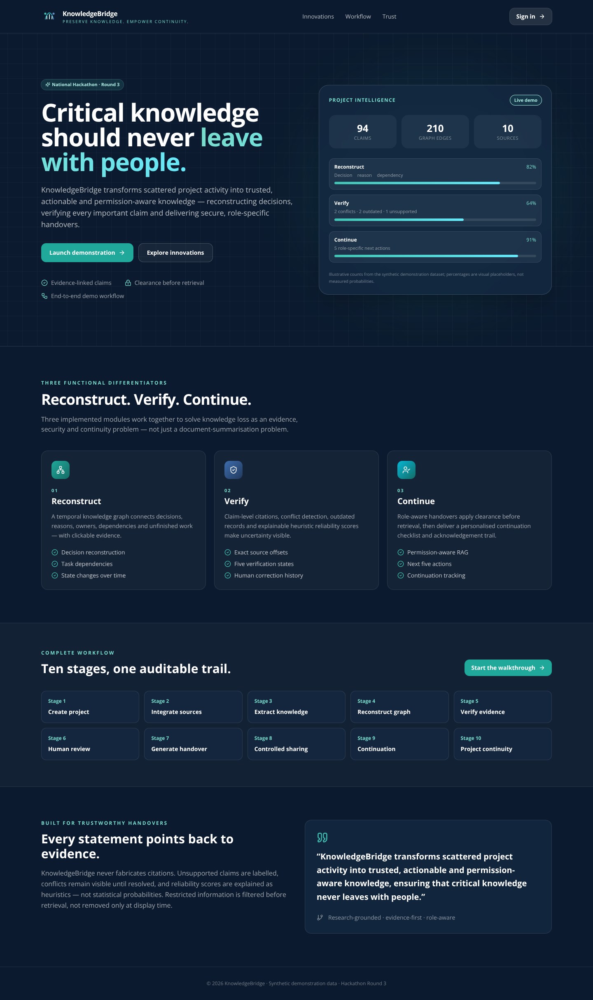
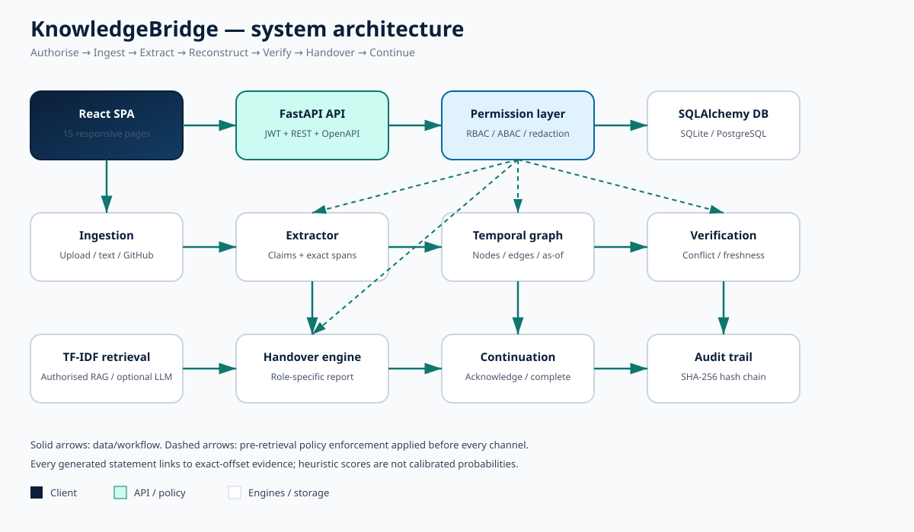
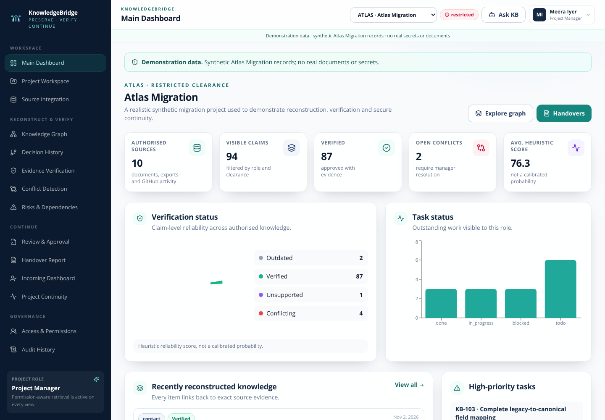
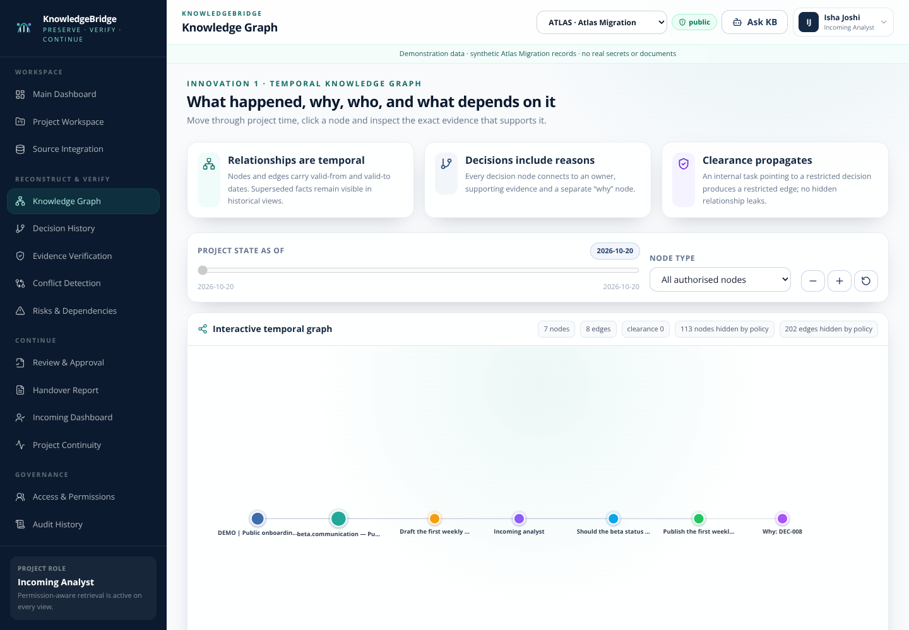

# KnowledgeBridge

**Preserve Knowledge. Empower Continuity.**

> An intelligent AI-powered knowledge-handover platform that reconstructs project history, verifies evidence, detects risks and generates secure, role-specific handovers for seamless project continuity.

Intended repository-ready name: **`knowledgebridge-ai-handover`**. The current
Arena checkout remains `Rampurkar91/Critical-Knowledge`; it has not been renamed
or overwritten. See `docs/REPOSITORY.md`.

**Reconstruct · Verify · Continue**

KnowledgeBridge converts scattered, authorised project activity into structured,
traceable, actionable and permission-aware knowledge. It is a working full-stack
application — not a UI mockup or a plan — built for the National Hackathon Round 3
challenge “Prevent Critical Knowledge From Leaving With People”.



---

## Contents

- [What is implemented](#what-is-implemented)
- [Three mandatory innovations](#three-mandatory-innovations)
- [Application modules and workflow](#application-modules-and-workflow)
- [Measured results](#measured-results)
- [Quick start](#quick-start)
- [Demo accounts and 11-step walkthrough](#demo-accounts-and-11-step-walkthrough)
- [Architecture and diagrams](#architecture-and-diagrams)
- [API documentation](#api-documentation)
- [Repository structure](#repository-structure)
- [Research documentation](#research-documentation)
- [Testing and evaluation](#testing-and-evaluation)
- [Security and privacy](#security-and-privacy)
- [Scope, limitations and source-of-truth note](#scope-limitations-and-source-of-truth-note)
- [Screenshots](#screenshots)
- [License](#license)

---

## What is implemented

- **React 18 + Tailwind CSS + Vite** responsive SaaS UI in navy/teal, sidebar navigation, 15 pages, interactive temporal graph, charts and status indicators.
- **Python FastAPI REST API** with Pydantic validation, SQLAlchemy 2 models, JWT auth, CORS and OpenAPI docs.
- **SQLite by default**, PostgreSQL via `DATABASE_URL`; Docker Compose includes PostgreSQL.
- **Deterministic evidence-preserving extraction** with exact source character offsets; optional OpenAI-compatible grounded LLM adapter and optional read-only GitHub integration.
- **Permission-aware TF-IDF lexical retrieval** with synonym expansion and source deduplication; no mandatory neural embedding/vector database dependency.
- **RBAC + ABAC**: six role policies, four classification levels, persisted per-member clearance, claim-type and tag allowlists, pre-retrieval SQL filtering, restricted-phrase redaction and SHA-256 hash-chained audit logs.
- **17 functional modules**: registration/auth; organisation/project management; document ingestion; GitHub integration; AI extraction; temporal graph; decision reconstruction; evidence verification; conflict/outdated detection; risk/dependency identification; human review/approval; RBAC; personalised handover; successor action planning; acknowledgement; audit history; continuity dashboard.
- **10-stage workflow** from project/team creation through source integration, extraction, reconstruction, verification, human review, handover generation, controlled sharing, continuation and continuity tracking.
- **Clearly labelled synthetic demonstration dataset**: 10 sources, 15 tasks, 9 decisions, 24 dependency pairs, 7 risks + 2 blockers, 2 deliberate conflicts, 2 outdated records, 1 unsupported claim, 5 unfinished-work records, 7 unresolved questions, different roles/clearances and a restricted canary.
- **Professional repository assets**: README, architecture/workflow diagrams, API docs, security model, research notes, demo guide, testing instructions, measured evaluation report, Docker configuration and GitHub Actions CI.

## Three mandatory innovations

1. **Temporal Project Knowledge Graph & Decision Reconstruction** — `knowledge_graph/`, `ai_engine/extractor.py`, `frontend/src/components/GraphExplorer.jsx`. Authorised historical records become decisions with reasons, owners, dependencies, state changes, unfinished work and unresolved questions. The as-of graph supports filtering, pan/zoom and node click-through to original evidence. Output exposes what happened, why, who, dependencies and unfinished work.
2. **Evidence-Based Knowledge Reliability & Conflict Detection Engine** — `verification_engine/`, `frontend/src/pages/VerificationDashboard.jsx`, `ConflictDashboard.jsx`. Claim→source links, contradictions, outdated information, missing evidence, exact statuses `Verified`, `Needs Review`, `Conflicting`, `Unsupported`, `Outdated`, explainable heuristic scores, authorised correction/rejection and verification/approval history. No fabricated citations, evidence or calibrated-probability claims.
3. **Role-Aware Adaptive Handover & Project Continuity Engine** — `handover_engine/`, `backend/app/services/permissions.py`, `frontend/src/pages/HandoverReport.jsx`, `IncomingDashboard.jsx`, `ContinuityDashboard.jsx`. Role-specific reports, access control before retrieval/sharing, responsibilities, priority checklist, next five actions, missing knowledge, acknowledgement tracking, task continuation/completion, shared-info audit trail and personalised dashboard. Restricted information is blocked across summaries, search, AI answers, exports and graph relationships.

## Application modules and workflow

The 15 frontend pages are: landing, login/register, dashboard, project workspace,
source integration, graph explorer, decision history, verification dashboard,
conflict dashboard, risk/dependency manager, review/approval centre, handover
report, incoming-member dashboard, continuity dashboard, access/permission
management and audit history. The dashboard/continuity/access/audit pages share
a responsive authenticated layout.

The 10 stages are documented in `docs/WORKFLOW.md`; the 11 required demo steps
are in `docs/DEMO_GUIDE.md`.

## Measured results

Actual measurements are in `reports/EVALUATION_REPORT.md` and
`reports/evaluation.json`; generate them with
`reports/generate_evaluation.py`. Latest measured run:

| Area | Result |
| --- | --- |
| Unit + integration tests | **11 passed, 0 failed** |
| Extraction label precision / recall / F1 | **1.0 / 1.0 / 1.0** (70/70 labels) |
| Exact evidence-offset accuracy | **1.0** (93/93 spans) |
| Retrieval mean precision@5 / recall@5 | **0.44 / 1.0** over 5 labelled queries |
| Conflict / outdated / unsupported F1 | **1.0 / 1.0 / 1.0** |
| Dependency-pair F1 | **1.0** (24/24) |
| Representative gold-edge recall | **1.0** (12/12) |
| Graph | **120 nodes / 210 edges**, 24 `depends_on` edges |
| Handover section coverage / evidence-link rate | **8/8 / 35/35** |
| Next-action recommendation F1 | **1.0**, exact priority-order match |
| Restricted marker leaks | **0** across 9 low-clearance channels |
| Audit hash-chain continuity | **valid** |

Separate implementation smoke tests are documented in
`reports/OPTIONAL_INTEGRATIONS.md` (local mock GitHub and OpenAI-compatible
adapters; 15 authorised sources after ingestion; 0 external API calls) and
`reports/UI_ROUTE_CHECK.md` / `reports/ui_route_check.json` (17 UI routes,
0 runtime errors and 0 failed API responses). These are runtime checks, not accuracy benchmarks.

Heuristic reliability/retrieval scores are **not statistically calibrated
probabilities**. Incoming-member task understanding, real human preparation-time
reduction and human-factors correction rates are explicitly **not measured**.
No live external LLM, GitHub, PostgreSQL, FAISS/ChromaDB or human-subject
evaluation was performed.

## Quick start

### Requirements

- Python 3.11+
- Node.js 20+
- Optional Docker + Docker Compose

### Local development

```bash
git clone <this-repository-url>
cd Critical-Knowledge

python3 -m venv .venv
.venv/bin/pip install -r requirements.txt

cp .env.example .env      # edit JWT_SECRET before any real deployment
cd frontend
npm ci
npm run build             # produces frontend/dist for single-process serving
cd ..
```

Start the API (port 8000):

```bash
.venv/bin/uvicorn backend.app.main:app --reload --host 0.0.0.0 --port 8000
```

For a separate live frontend with hot reload:

```bash
cd frontend
npm run dev -- --host 0.0.0.0 --port 5173
```

Open `http://localhost:8000` for the combined build or `http://localhost:5173`
for the Vite dev server. Interactive API docs are at `http://localhost:8000/docs`.

On first start, `SEED_DEMO_DATA=true` creates the synthetic Atlas Migration
project, demo users, 10 sources and the reconstructed graph/verification state.

### Docker Compose

```bash
cp .env.example .env
docker compose up --build
```

- Frontend: `http://localhost:3000`
- API/docs: `http://localhost:8000`
- PostgreSQL: internal `postgres:5432`

## Demo accounts and 11-step walkthrough

All demo passwords default to `DemoPass!2026` (`DEMO_PASSWORD` in `.env.example`).
Change this value outside a local demo.

| Email | Role | Clearance |
| --- | --- | ---: |
| `manager@knowledgebridge.demo` | Project Manager | 3 |
| `lead@knowledgebridge.demo` | Technical Lead | 2 |
| `engineer@knowledgebridge.demo` | Incoming Engineer | 1 |
| `analyst@knowledgebridge.demo` | Incoming Analyst | 0 |
| `auditor@knowledgebridge.demo` | Auditor | 2 |

Full walkthrough: `docs/DEMO_GUIDE.md`. It covers upload docs → extract →
reconstruct graph → explore decisions → identify conflicts/outdated records →
inspect evidence → review/approve → generate actionable handover → switch to
incoming-member account → verify restricted info is inaccessible → display
personalised next actions.

## Architecture and diagrams



- `docs/ARCHITECTURE.md` — layers, design principles, classifications, deployment shapes and Mermaid diagram.
- `docs/WORKFLOW.md` — 10-stage workflow Mermaid diagram.
- `docs/diagrams/workflow.svg` — 10-stage diagram.
- `docs/diagrams/data-model.svg` — core entity diagram.

## API documentation

Interactive OpenAPI: `/docs` and `/openapi.json`. Static endpoint catalogue:
`docs/API.md`. All project endpoints require a JWT and active membership;
responses are permission-filtered before serialisation.

## Repository structure

```text
frontend/                 React + Tailwind SPA, 15 pages, graph explorer
backend/app/              FastAPI app, models, schemas, routers, services
ai_engine/                extractor, TF-IDF retrieval, optional grounded LLM
knowledge_graph/           temporal graph builder
verification_engine/       conflict/freshness/review/approval engine
handover_engine/           role-aware generation, export, item actions
database/                  SQLite runtime location / DB notes
sample_data/               labelled synthetic demo sources, manifest, gold labels
tests/                     unit + integration tests
reports/                   measured evaluation report + pytest output
docs/                      architecture, workflow, API, security, research, demo
docs/diagrams/             SVG architecture/workflow/data-model diagrams
docs/screenshots/          real UI screenshots
docker/                    backend/frontend Dockerfiles + nginx config
.github/workflows/         CI pipeline
README.md LICENSE .gitignore .env.example docker-compose.yml
```

## Research documentation

- `docs/RESEARCH_OVERVIEW.md` — position statement, product landscape and shared references.
- `docs/RESEARCH_TEMPORAL_GRAPH.md` — innovation 1.
- `docs/RESEARCH_EVIDENCE_VERIFICATION.md` — innovation 2.
- `docs/RESEARCH_ROLE_AWARE_CONTINUITY.md` — innovation 3.

Each research note covers research problem, existing approaches, limitations,
gap, proposed solution, architecture, methodology, expected contribution and
evaluation metrics. Real papers and official product documentation are cited.
The project claims an **integration and measured synthetic-dataset
contribution**, not worldwide novelty or production accuracy.

## Testing and evaluation

```bash
.venv/bin/python -m pytest -q
.venv/bin/python reports/generate_evaluation.py
.venv/bin/python reports/exercise_optional_integrations.py
cd frontend && npm ci && npm run build
cd tools/browser && npm ci && npm run check:routes
```

See `docs/TESTING.md` for test scope, measured results and reproduction steps.

## Security and privacy

- Passwords: PBKDF2-HMAC-SHA256; JWT auth; no plaintext password storage/logging.
- Classification: `0 public / 1 internal / 2 confidential / 3 restricted`.
- Access control is applied before retrieval/sharing; hidden dependency refs are masked and restricted phrases are redacted.
- Handovers require manager review/approval before sharing and are recipient-scoped.
- Append-only SHA-256 hash-chained audit log records ingestion, extraction, reviews, approvals, shares, exports, denials, redactions and acknowledgements.
- `.env.example` contains demo defaults and empty optional credentials. No API keys, passwords, private documents or confidential data are included.
- See `docs/SECURITY.md` for the full model and limitations.

## Scope, limitations and source-of-truth note

The official attached PDF requested in the master prompt was **not present** in
the workspace; a recursive search found no PDF/DOCX/PPTX/attachment files. The
checkout originally contained only a placeholder `README.md`, so there was no
existing codebase or stack to preserve and no PDF contents were invented. The
official problem statement in the prompt was used as the source of truth. See
`docs/PDF_GAP.md`.

Implemented and runtime-validated: FastAPI import/startup, SQLite schema,
idempotent synthetic seed, extraction, graph rebuild, verification, API routes,
unit/integration workflow, frontend production build, 17 real UI screenshots,
a 17-route browser smoke check with zero failures, optional upload/GitHub/LLM
endpoint paths against local mocks, and the measured evaluation.

Not exercised with real external services: live OpenAI-compatible LLM calls,
live GitHub API calls, PostgreSQL deployment, FAISS/ChromaDB, neural embeddings,
cloud deployment, human-subject studies and independent penetration testing.
Docker/Compose configuration is provided but Docker itself was not run in this
sandbox. The original repository was not renamed. Creating the separate target
repository was blocked by the GitHub integration token's repository-creation
permission; see `docs/REPOSITORY.md`.

## Screenshots

| Page | Screenshot |
| --- | --- |
| Landing | `docs/screenshots/landing.png` |
| Manager dashboard | `docs/screenshots/dashboard.png` |
| Temporal graph | `docs/screenshots/graph.png` |
| Verification | `docs/screenshots/verification.png` |
| Handover report | `docs/screenshots/handover.png` |
| Incoming dashboard | `docs/screenshots/incoming.png` |

Full 17-page gallery and capture manifest: `docs/screenshots/README.md` and
`docs/screenshots/capture-manifest.json`.





## License

MIT — see `LICENSE`.

KnowledgeBridge transforms scattered project activity into trusted, actionable and permission-aware knowledge, ensuring that critical knowledge never leaves with people.
