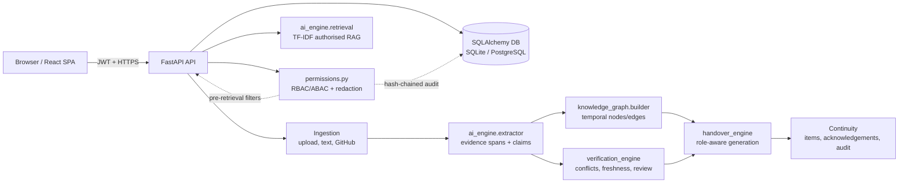

# KnowledgeBridge architecture

## System overview

KnowledgeBridge is a FastAPI + React application that turns authorised project
sources into evidence-linked claims, a temporal knowledge graph, reviewed
handovers and continuation telemetry. The default deployment is SQLite and a
deterministic local extraction/retrieval engine; PostgreSQL is supported through
`DATABASE_URL`. Optional OpenAI-compatible LLM and read-only GitHub adapters are
isolated behind small interfaces.

A renderable SVG version is in `docs/diagrams/architecture.svg`.

## Layer responsibilities

| Layer | Path | Responsibility |
| --- | --- | --- |
| UI | `frontend/src/` | 15 responsive React pages, sidebar, temporal graph, status indicators, visualisations. |
| API | `backend/app/routers/` | Auth/meta, projects/members, knowledge/search/ask, verification/reviews/audit, handovers/items. |
| Security | `backend/app/services/permissions.py` | Membership, role actions, classification clearance, persisted claim-type/tag ABAC, evidence citations, restricted-phrase guard, SHA-256 audit hash chain. |
| Extraction | `ai_engine/extractor.py` | Deterministic parse of labelled Markdown records into exact-offset evidence spans, claims, tasks, risks and dependency claims. |
| Retrieval | `ai_engine/retrieval.py` | Permission-aware TF-IDF lexical retrieval over authorised claim/evidence documents; optional grounded LLM adapter in `ai_engine/llm.py`. |
| Graph | `knowledge_graph/builder.py` | Rebuilds temporal nodes/edges, propagates the maximum sensitivity across endpoints, records `valid_from`/`valid_to` and supersession. |
| Verification | `verification_engine/engine.py` | Exact status categories, conflict keys, freshness, unsupported claims, heuristic explainable scores, review/correct/approve and conflict resolution. |
| Handover | `handover_engine/generator.py` | Role-specific report, next five actions, checklist, evidence register, uncertainty, acknowledgement/completion items, export and redaction guard. |
| Data | `backend/app/models.py`, `database/` | 17 SQLAlchemy tables; SQLite file by default, PostgreSQL via `DATABASE_URL`. |
| Demo data | `sample_data/` | Clearly labelled synthetic sources, manifest and gold labels. |

## Design principles

1. **Authorise before retrieval.** Every project query is constrained by active membership, role action, classification clearance and persisted claim-type/tag allowlists.
2. **Evidence before assertion.** Claims carry exact source character offsets; handover statements are omitted if their evidence is unavailable or contains hidden identifiers.
3. **Human review before sharing.** Handovers start as `draft`, can be corrected/edited, must be approved, and only then shared.
4. **Explainable heuristics, not probabilities.** Reliability scores are 0–100 heuristics with rationales; the UI and API explicitly state they are not statistically calibrated probabilities.
5. **Defence in depth.** SQL filters are primary; serialisation guards, dependency masking, restricted-phrase redaction and audit logs are secondary.
6. **No unnecessary infrastructure.** The zero-setup demo needs only Python and Node. No FAISS/ChromaDB, neural embedding service or mandatory LLM is required.

## Data classifications

| Level | Label | Demo behaviour |
| --- | --- | --- |
| 0 | public | Visible to analyst/observer roles. |
| 1 | internal | Visible to incoming engineer. |
| 2 | confidential | Visible to technical lead/auditor. |
| 3 | restricted | Visible only to project manager. Restricted canary `RESTRICTED-CANARY-9F3A` is never shown in low-clearance channels. |

## Deployment shapes

- **Local development:** `uvicorn backend.app.main:app --reload` and `npm run dev` in `frontend/`; Vite proxies `/api`, `/docs` and `/openapi.json` to port 8000.
- **Single-process demo:** build `frontend/dist`, then FastAPI serves the SPA fallback from port 8000.
- **Docker Compose:** PostgreSQL + backend + nginx-served frontend; see `docker-compose.yml` and `docker/`.
- **Cloud-ready notes:** set `DATABASE_URL`, a strong `JWT_SECRET`, and TLS at the ingress. Keep `GITHUB_TOKEN`/`LLM_API_KEY` in the environment/secret manager, never in the database or repository.

The Compose configuration and PostgreSQL driver are provided, but the measured evaluation in `reports/EVALUATION_REPORT.md` ran on SQLite and did not exercise a live PostgreSQL deployment.
