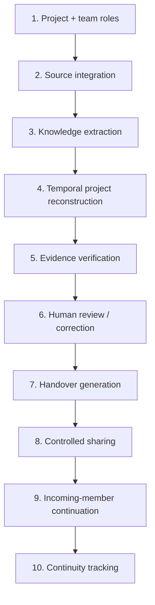

# Ten-stage KnowledgeBridge workflow

A renderable SVG version is in `docs/diagrams/workflow.svg`.

| Stage | Implemented functionality | Main files |
| --- | --- | --- |
| 1. Project creation / team roles | Registration, organisation/project creation, membership, six role policies, clearance and claim-type/tag allowlists. | `backend/app/routers/auth.py`, `projects.py`, `services/permissions.py` |
| 2. Source integration | Text/upload/GitHub source creation, SHA-256, front-matter classification, audit events. | `services/ingestion.py`, `services/github.py`, `routers/knowledge.py` |
| 3. Knowledge extraction | Deterministic records → exact-offset evidence spans, claims, tasks, risks, dependency claims. | `ai_engine/extractor.py` |
| 4. Project reconstruction | Temporal graph nodes/edges, reasons, owners, dependencies, state changes, supersession, as-of timeline. | `knowledge_graph/builder.py`, `frontend/src/components/GraphExplorer.jsx` |
| 5. Evidence verification | Five exact statuses, conflict detection, outdated/unsupported detection, explainable heuristic scores. | `verification_engine/engine.py` |
| 6. Human review / correction | Pending queue, approve/reject/correct, conflict resolution, versioned replacement claims, review history. | `verification_engine/engine.py`, `routers/verification.py` |
| 7. Handover generation | Role-aware sections, next five actions, checklist, evidence register, uncertainty, applied filters. | `handover_engine/generator.py` |
| 8. Controlled sharing | Draft → manager edit → approve → share; recipient scoping, classification guard, export guard. | `routers/handovers.py` |
| 9. Continuation | Personalised incoming dashboard, acknowledgement, start/complete task actions. | `handover_engine/generator.py`, `frontend/src/pages/IncomingDashboard.jsx` |
| 10. Continuity tracking | Acknowledgement/completion rates, overdue items, open questions, correction rate, prep-time telemetry, audit history. | `routers/verification.py`, `frontend/src/pages/ContinuityDashboard.jsx` |

## Eleven-step demonstration

The `docs/DEMO_GUIDE.md` walks through the 11 required steps: upload docs, extract,
reconstruct graph, explore decisions, identify conflicts/outdated records,
inspect evidence, review/approve, generate an actionable handover, switch to the
incoming-member account, verify restricted information is inaccessible, and
display personalised next actions.
